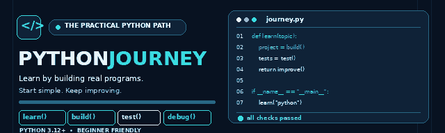

<div align="center">
  
  <h1>🐍 Python Journey</h1>
  <p><strong>Học Python bằng cách xây dựng — không chỉ học cú pháp.</strong></p>
  <p><code>Learn → Build → Test → Debug → Improve → Commit → Prove</code></p>

  <p>
    
    
    
    <a href="LICENSE"></a>
  </p>

  <p>
    <a href="#-bắt-đầu">🚀 Bắt đầu</a> ·
    <a href="#-lộ-trình-15-tuần">🗺️ Lộ trình</a> ·
    <a href="#-thực-hành-qua-dự-án">🛠️ Dự án thực hành</a> ·
    <a href="#-tài-liệu">📚 Tài liệu</a>
  </p>
</div>

---

## ✨ Python Journey là gì?

**Python Journey** là lộ trình Python nền tảng trong 15 tuần, dành cho người mới bắt đầu hoặc người muốn củng cố cách viết chương trình rõ ràng và đáng tin cậy.

Thay vì học cú pháp rồi để đó, mỗi khái niệm được áp dụng ngay vào bài tập và dự án nhỏ.

| 📖 Học | 🛠️ Xây dựng | 🧪 Kiểm chứng |
|:--|:--|:--|
| Hiểu một khái niệm qua ví dụ ngắn | Dùng nó giải quyết một vấn đề thực tế | Chạy thử, kiểm tra lỗi và giải thích kết quả |

### Sau lộ trình, bạn sẽ thực hành được

- Viết chương trình với biến, điều kiện, vòng lặp và hàm.
- Làm việc với chuỗi, danh sách, từ điển, tập hợp và dữ liệu lồng nhau.
- Đọc/ghi tệp, JSON, xử lý ngoại lệ và debug lỗi.
- Tổ chức chương trình thành module, dùng CLI và làm quen HTTP/API.
- Dùng class, composition và inheritance ở mức cơ bản.
- Viết test và dùng Git/GitHub để theo dõi quá trình phát triển.

## 🗺️ Lộ trình 15 tuần

| Tuần | Chủ đề | Kết quả thực hành |
|:--:|---|---|
| 01 | Môi trường, terminal, Git/GitHub, Hello Python | Chạy và commit chương trình đầu tiên |
| 02 | Biến, kiểu dữ liệu, input/output | Chương trình xử lý dữ liệu |
| 03 | Điều kiện, Boolean, kiểm tra dữ liệu đầu vào | Chương trình ra quyết định |
| 04 | Chuỗi, xử lý văn bản, regex cơ bản | Text Analyzer |
| 05 | List, tuple, mutability, unpacking | Quản lý dữ liệu tuần tự |
| 06 | Vòng lặp, `enumerate`, `zip`, comprehensions | Xử lý tập dữ liệu |
| 07 | Hàm, phân rã vấn đề, scope, type hints | Bộ hàm tiện ích |
| 08 | Dict, set, dữ liệu lồng nhau | Word/Data Counter |
| **09** | **Midterm Project** | **Gộp kiến thức tuần 01–08 thành ứng dụng console** |
| 10 | Tệp, `pathlib`, CSV, JSON | Lưu và đọc dữ liệu |
| 11 | Exceptions, traceback, debugging | Xử lý lỗi có phương pháp |
| 12 | Testing với `pytest` | Test hành vi và trường hợp biên |
| 13 | Modules, packages, dependencies, CLI, HTTP/API | Chương trình nhiều module |
| 14 | OOP, composition, inheritance cơ bản | Mô hình hóa bằng class |
| **15** | **Capstone Project** | **Dự án cuối khóa có code, test và README** |

Xem [đề cương đầy đủ](SYLLABUS.md) hoặc [theo dõi tiến độ](PROGRESS.md).

## 🛠️ Thực hành qua dự án

### Study Task Manager — ví dụ đời sống từ Week 13–14

Một ứng dụng dòng lệnh nhỏ để quản lý việc học. Dự án kết hợp các kiến thức: module/package, `argparse`, lưu dữ liệu JSON, class, composition và inheritance.

- [Hướng dẫn Week 13 — Modules, CLI, HTTP/API](weeks/week-13-modules-cli-api/README.md)
- [Hướng dẫn Week 14 — OOP Essentials](weeks/week-14-oop-essentials/README.md)
- [Tài liệu ôn tập chung Week 13–14](weeks/week-13-14-review.md)
- [Mã nguồn và cách chạy Study Task Manager](weeks/week-13-14-life-project/README.md)

Thử chạy ứng dụng:

```bash
cd weeks/week-13-14-life-project

python -m study_app.cli add "Ôn OOP"
python -m study_app.cli add "Làm bài Python" --subject Python
python -m study_app.cli list
python -m study_app.cli done 1
```

Ứng dụng lưu danh sách công việc vào tệp JSON trong thư mục người dùng. Bạn có thể đọc mã nguồn, chạy từng lệnh rồi thay đổi để hiểu từng phần hoạt động ra sao.

## 🔄 Cách học mỗi tuần

1. Đọc `README.md` của tuần để biết mục tiêu.
2. Xem notes và ví dụ chạy được.
3. Tự hoàn thành bài tập trước khi xem lời giải.
4. Chạy bài kiểm tra hoặc tự tạo trường hợp thử.
5. Sửa lỗi, giải thích kết quả và ghi lại điều đã học.
6. Commit thay đổi bằng Git.

**Nguyên tắc cốt lõi:** ưu tiên bằng chứng hơn phỏng đoán, thiết kế đơn giản hơn sự phức tạp không cần thiết, và sự hiểu bài hơn việc chép code.

## 🚀 Bắt đầu

### 1. Chuẩn bị

- Python **3.12 trở lên**
- Git
- Trình soạn thảo code bạn quen dùng

Nếu cần hướng dẫn cài đặt hoặc xử lý lỗi môi trường, xem [SETUP.md](SETUP.md).

### 2. Tải repository

```bash
git clone https://github.com/Noah-12111/python-0-Hero.git
cd python-0-Hero
```

### 3. Chọn một bài để chạy

Ví dụ với bài CLI của Week 13:

```bash
cd weeks/week-13-modules-cli-api
python -m exercises.ex02_cli --turn 3
```

Hãy đọc README của từng tuần để biết mục tiêu, cách chạy bài tập và cách tự kiểm tra kết quả.

## 📂 Cấu trúc repository

```text
python-0-Hero/
├── README.md              # Trang tổng quan và lối vào
├── SYLLABUS.md            # Đề cương 15 tuần
├── SETUP.md               # Cài đặt môi trường
├── STYLE_GUIDE.md         # Hướng dẫn phong cách code
├── PROGRESS.md            # Theo dõi tiến độ
├── FINAL_PROJECT.md       # Yêu cầu Capstone
├── weeks/                 # Bài học, bài tập và mini-project
├── projects/              # Dự án xuyên suốt khóa học
├── tests/                 # Kiểm tra chất lượng repository
└── assets/                # Hình minh họa và tài liệu bổ trợ
```

## 📚 Tài liệu

| Tài liệu | Dùng để |
|---|---|
| [SYLLABUS.md](SYLLABUS.md) | Xem toàn bộ lộ trình học |
| [SETUP.md](SETUP.md) | Cài đặt Python và công cụ cần thiết |
| [PROGRESS.md](PROGRESS.md) | Ghi lại tiến độ từng tuần |
| [STYLE_GUIDE.md](STYLE_GUIDE.md) | Viết code dễ đọc và nhất quán |
| [FINAL_PROJECT.md](FINAL_PROJECT.md) | Đọc yêu cầu dự án cuối khóa |
| [VuaCóc Bot Journey](projects/vuacoc-bot-journey/README.md) | Theo dõi một dự án xuyên suốt các chủ đề |

---

<div align="center">
  <p><strong>Learn it. Build it. Test it. Understand it. Improve it.</strong></p>
  <p><em>From zero to reliable Python.</em></p>
  <p>⭐ Nếu repository này hữu ích cho việc học của bạn, hãy Star để lưu lại hành trình nhé!</p>
</div>
